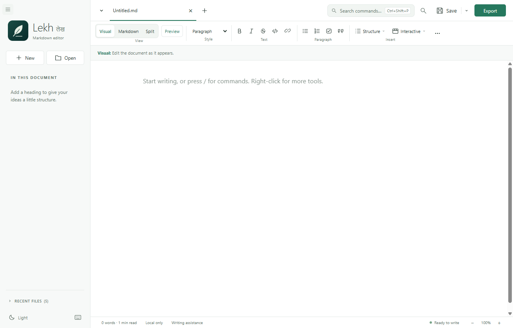
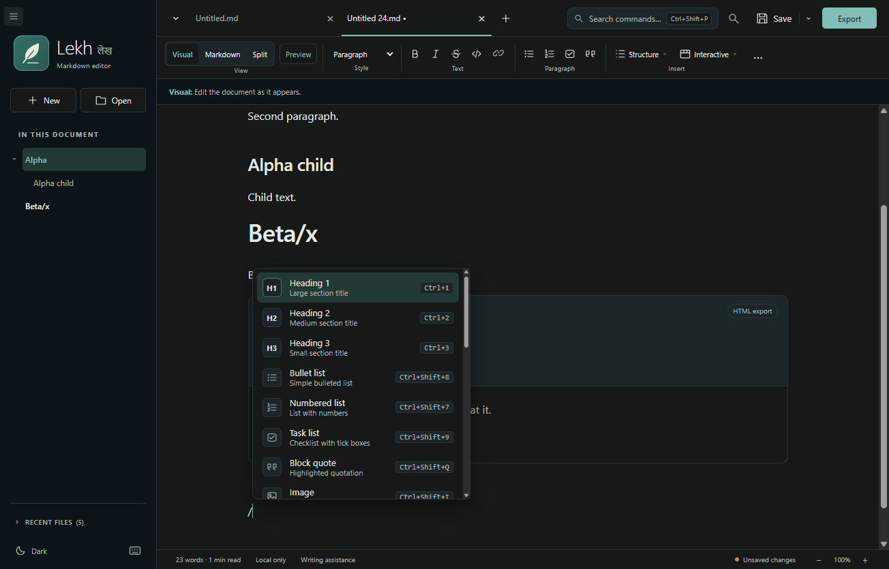
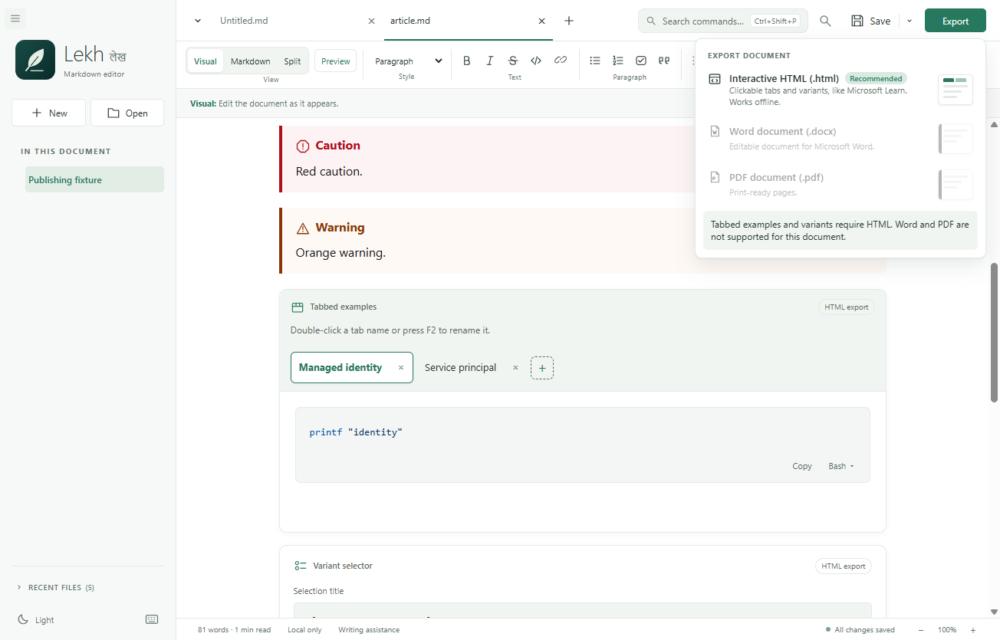
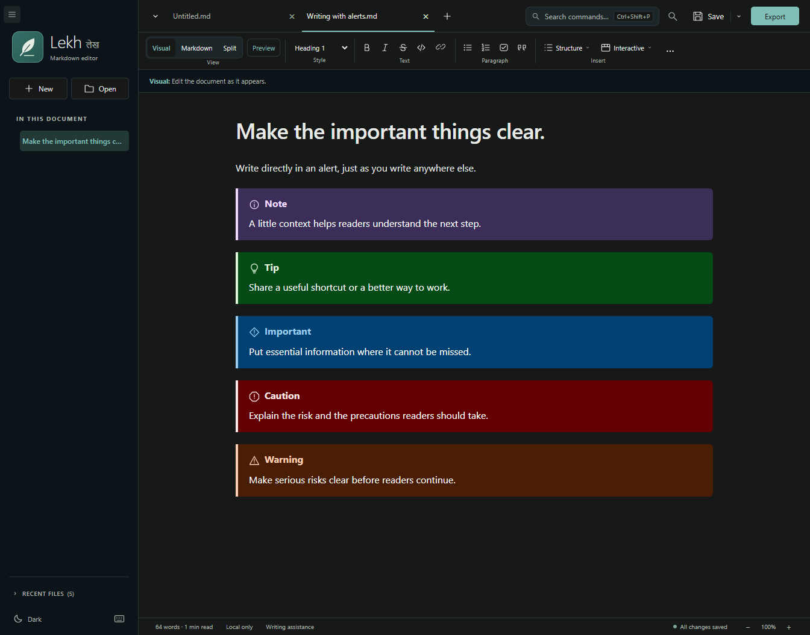
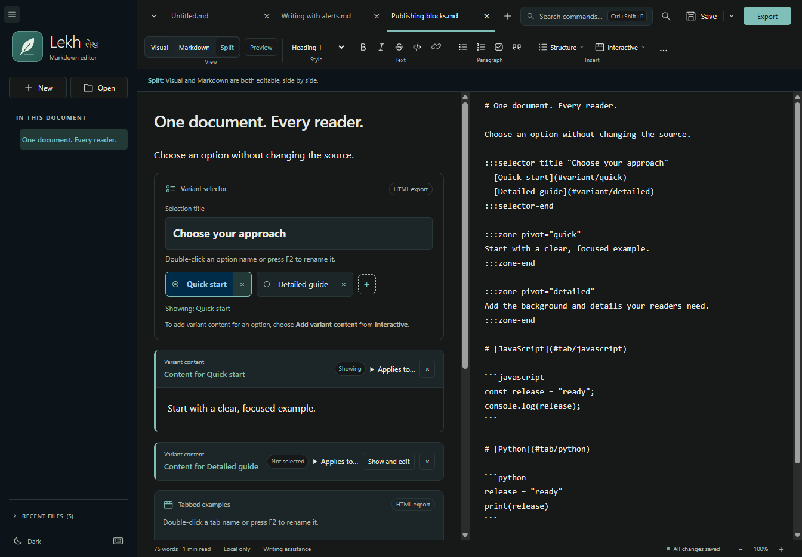
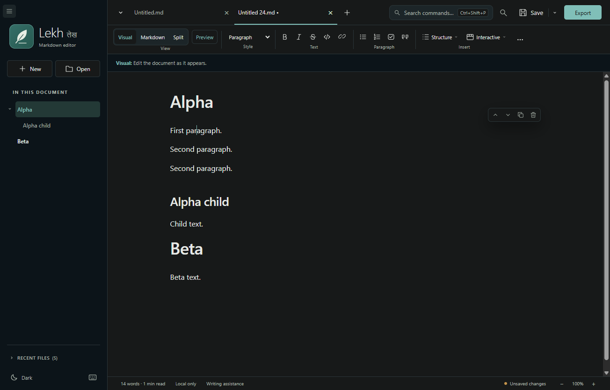
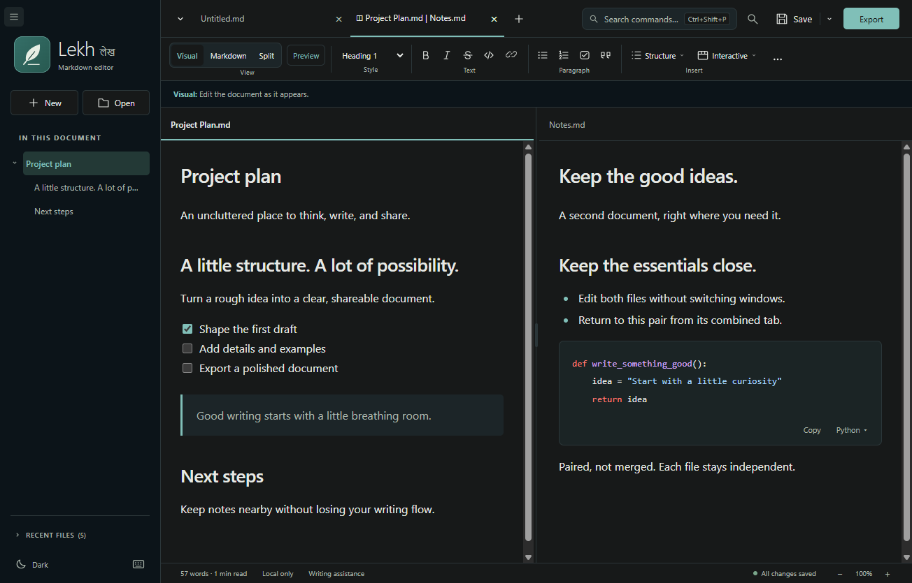

<p align="center">
  
</p>

<h1 align="center">Lekh लेख</h1>

<p align="center">
  <b>A calm, local-first Markdown editor for Windows.</b><br>
  Write visually, keep exact Markdown, and export polished documents — all offline.
</p>

<p align="center">
  <a href="https://github.com/dennispadia/lekh/releases/latest"></a>
  
  <a href="LICENSE"></a>
  
</p>

<p align="center">
  <a href="https://github.com/dennispadia/lekh/releases/latest"><b>Download Lekh</b></a> ·
  <a href="docs/USER_GUIDE.md">User guide</a> ·
  <a href="https://github.com/dennispadia/lekh/issues">Report an issue</a>
</p>



> *Lekh* (लेख) means "article" or "writing" in Hindi. The editor is built for people who write long-form technical documents — and want them to look good without leaving their own computer.

## Why Lekh?

- ✍️ **Write the way you think.** Format visually like a word processor, or switch to Markdown for exact syntax. Or keep both side by side, editing either one.
- ⚡ **Everything is one keystroke away.** Search every command with **Ctrl+Shift+P**, type `/` on an empty line to insert any block, and move whole sections from the outline.
- 📚 **Publishing-ready blocks.** Alerts, tabbed examples, variant selectors and YAML metadata — edited directly in place, written as standard Docs-style Markdown.
- 📤 **Export that respects your document.** Interactive HTML for offline review, editable Word, and print-ready PDF.
- 🔒 **Private by design.** No account, no cloud, no analytics. Your files never leave your machine.

## Features

### Writing

| | |
| --- | --- |
| **Visual, Markdown and Split** | Choose an editable view, or open an interactive reader preview with optional editable Markdown on the right. Return to your previous view with **Back to editing**. |
| **Rich Markdown** | Headings, emphasis, lists, task lists, quotes, links, tables, images, rules and syntax-highlighted code. |
| **Mermaid diagrams** | Insert and edit diagrams that render offline, right where your cursor is. |
| **Find and replace** | Match case, whole word and regex, with live match counts and one-step Replace all. |
| **Writing assistance** | Optional offline English grammar checks. Review each suggestion; nothing is changed automatically or sent online. |

### Working faster

| | |
| --- | --- |
| **Command palette** | **Ctrl+Shift+P** or the header search finds every action, block, view and export by name. |
| **Slash menu** | A blank-document hint shows how to get started. Type `/` on an empty Visual line for headings, lists, tables, alerts and publishing blocks. |
| **Block toolbar** | Click into content to move it up or down, duplicate it or remove it. Also on **Alt+Shift+Up/Down**, **Edit** and right-click **Edit**. |
| **Smart outline** | Collapse and expand headings, and drag a section (or press **Alt+Up/Down**) to move it with all its subsections. Moves never break tabs, zones or lists. |
| **Grouped toolbar** | One **Insert** section with Image, Table, Code, Alerts, Structure and Interactive. Structure and Interactive stay visible as lower-priority tools fold into **More**. |
| **Right-click everything** | Every toolbar feature is also in the context menu, fully keyboard accessible. |

### Publishing blocks

| | |
| --- | --- |
| **Alerts** | Note, Tip, Important, Caution and Warning, each with its own icon and Light/Dark colors. Type and format inside them directly. |
| **Tabbed examples** | Start with empty example bodies and click-away writing hints, not sample text to delete. Rename tabs in place; **+** adds one and **×** removes one. Names become `# [Name](#tab/name)` headings in Markdown. |
| **Variants** | Give the selector a title, rename choices in place, and use **+** or **×** to add or remove them. Choose **Interactive > Add variant content** wherever it belongs. |
| **Include** | Insert a title and path with **Structure > Include** to show shared local Markdown in Visual, Preview and exports without rewriting the source. |
| **Metadata** | One YAML box for any front-matter keys, kept out of the article body. |

### Workspace and safety

| | |
| --- | --- |
| **Tabs and split view** | Open many documents using the **+** next to the last tab, or pair two side by side with a resizable divider. |
| **Themes and focus** | Light and Graphite + Teal Dark themes, zoom, and distraction-free Focus mode (**F9**). |
| **Status at a glance** | Click the word count for full document statistics, or the save state to save. |
| **Never lose work** | Unsaved-change prompts, external-edit detection, atomic saves and recovery drafts. |

## Export: what works where

Export uses the active document, including unsaved edits, and never changes your Markdown file.

| Content | Interactive HTML | Word (.docx) | PDF |
| --- | :---: | :---: | :---: |
| Headings, emphasis, links, lists, task lists | ✅ | ✅ | ✅ |
| Tables (with column alignment) | ✅ | ✅ | ✅ |
| Syntax-colored code blocks | ✅ | ✅ | ✅ |
| Local images (PNG, JPEG, GIF) | ✅ embedded | ✅ | ✅ |
| WebP images | ✅ | ❌ convert first | ✅ |
| Mermaid diagrams | ✅ | ✅ | ✅ |
| Alerts | ✅ | ✅ | ✅ |
| Clickable table of contents and heading links | ✅ | ✅ | ✅ bookmarks |
| **Tabbed examples** | ✅ clickable tabs | ❌ | ❌ |
| **Variant selectors and content** | ✅ switchable | ❌ | ❌ |
| Works fully offline in a single file | ✅ | ✅ | ✅ |
| Editable by the recipient | — | ✅ | — |

**Good to know**

- **Tabs and variants need HTML.** Word and PDF can't show a choice, so they would print every alternative at once. When a document contains tabbed examples or variants, Lekh marks HTML as **Recommended** and disables Word and PDF with an explanation.
- **Interactive HTML** behaves like learn.microsoft.com: click tabs, switch variants, and review offline. Everything — images and diagrams included — is packed into one file.
- **Word** stays editable and reflows in Word, so it will not be pixel-identical to the PDF.
- **PDF** uses A4 pages with 20 mm margins and print-friendly colors, whatever editor theme you use.
- **Includes:** Local included Markdown appears in Visual and exports without its YAML metadata. The parent keeps the original directive; missing or unauthorized includes stop export with a clear error. Tabs or variants in an include also require HTML.
- **Not exported:** YAML metadata (kept as document data, not article text). Remote images stop export with a clear error rather than being dropped. Math and footnotes are not rendered as formatted output.

See [images and exports](docs/USER_GUIDE.md#images-and-exports) for details.

## A closer look

<table>
  <tr>
    <td width="50%"><br><sub><b>Slash menu</b> — insert any block without leaving the keyboard.</sub></td>
    <td width="50%"><br><sub><b>Export panel</b> — previews for each format, with HTML recommended for interactive content.</sub></td>
  </tr>
  <tr>
    <td><br><sub><b>Alerts</b> — type and format directly inside them.</sub></td>
    <td><br><sub><b>Publishing blocks</b> — controls stay with the document, beside exact Markdown.</sub></td>
  </tr>
  <tr>
    <td><br><sub><b>Block toolbar and outline</b> — rearrange content in a click.</sub></td>
    <td><br><sub><b>Split view</b> — two independent documents side by side.</sub></td>
  </tr>
</table>

## Install on Windows

Requires **Windows 10/11 x64** and .NET Framework 4.8 or newer (normally included in Windows).

1. Download the setup EXE from the **[latest Lekh release](https://github.com/dennispadia/lekh/releases/latest)** and compare it with `SHA256SUMS.txt`.
2. Run it. A fresh install starts straight away; no administrator access is needed.
3. Upgrading? If Lekh is closed, setup upgrades it automatically and shows the old and new versions. If Lekh is open, setup asks you to save and close it, then click **Check again**.

The same version reports **already installed**, and downgrades are blocked. Your settings and recovery drafts are kept across upgrades.

> [!WARNING]
> Lekh is not yet code-signed, so Windows or your organization may warn about or block the installer. Verify the checksum and follow your organization's policies; don't disable security protections. See [signing status](docs/PUBLISHING.md#code-signing-policy-pending).

<details>
<summary>Installation details</summary>

- Application files: `%LOCALAPPDATA%\lekh`; executable: `Lekh - Markdown editor.exe`.
- Preferences, recent files and recovery drafts: `%APPDATA%\Lekh`.
- Setup cache and logs: `%LOCALAPPDATA%\Lekh\SetupCache` and `%LOCALAPPDATA%\Lekh\SetupLogs`.
- Application ID `com.lekh.desktop`; MSI upgrade code `DCBCF7FA-11DA-4F35-8D27-D066EEC6C582`.
- The old version is removed before the new one is installed, with full rollback if setup is cancelled.
- Uninstall from **Settings > Apps > Installed apps**. Your Markdown files and settings profile are not deleted.

</details>

## Quick start

1. Open Lekh and start typing in the blank document, or open a `.md` file.
2. Type `/` for blocks, or press **Ctrl+Shift+P** to find any command.
3. Choose **Split** to edit Visual and Markdown together, or **Preview** to try tabs and choices as a reader.
4. Save with **Ctrl+S**. Choose **Export** for HTML, Word or PDF.
5. Press **F1** any time for the keyboard shortcut reference.

## Privacy

Documents stay on your computer. There are no accounts, uploads, cloud sync or analytics. Remote images are never downloaded, and external links open only after you confirm. Recovery drafts are a safety net, not a backup — keep your own backups.

## Build from source

With Windows x64 and Node.js 22.15.0 or newer:

```powershell
npm.cmd ci --registry=https://registry.npmjs.org
npm.cmd run build
.\node_modules\.bin\electron.cmd .
```

Or double-click `Launch.cmd`, which sets up a checksum-verified private Node runtime if needed. See [BUILDING.md](docs/BUILDING.md), [PUBLISHING.md](docs/PUBLISHING.md) and [CONTRIBUTING.md](CONTRIBUTING.md).

## Feedback and license

Questions, bugs and ideas are welcome in **[GitHub issues](https://github.com/dennispadia/lekh/issues)**. See [Help and feedback](SUPPORT.md).

Lekh is free to use and modify under the [MIT license](LICENSE).
