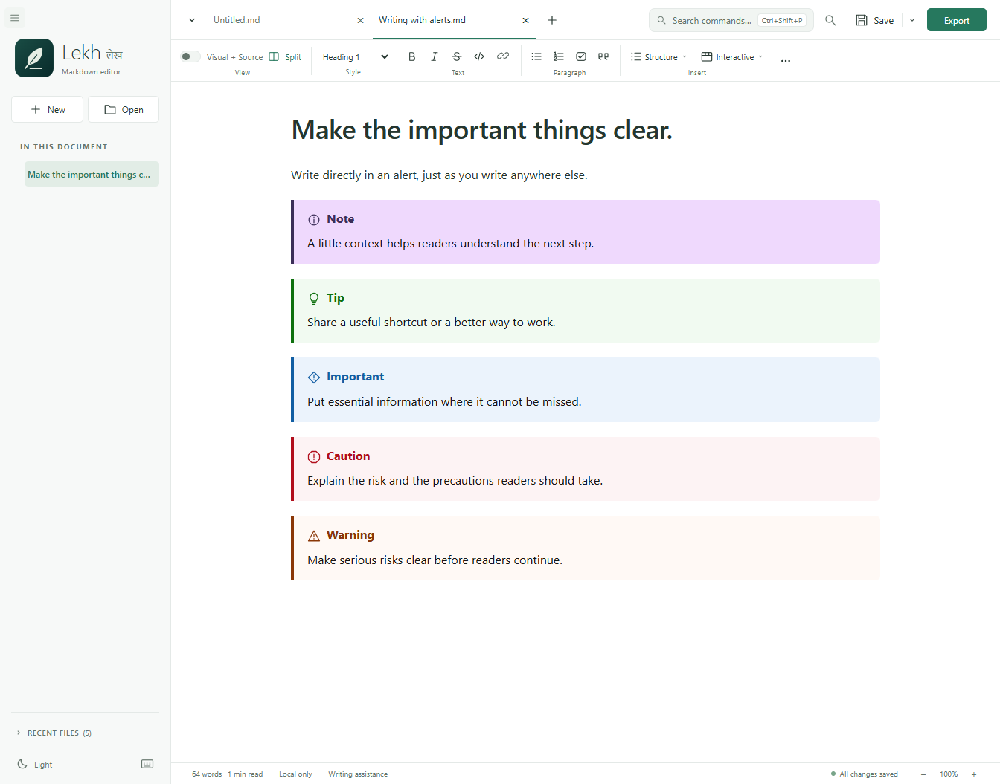
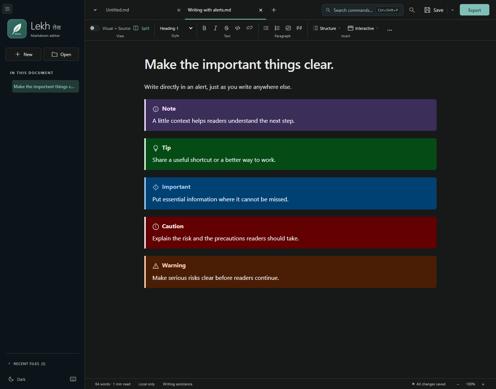
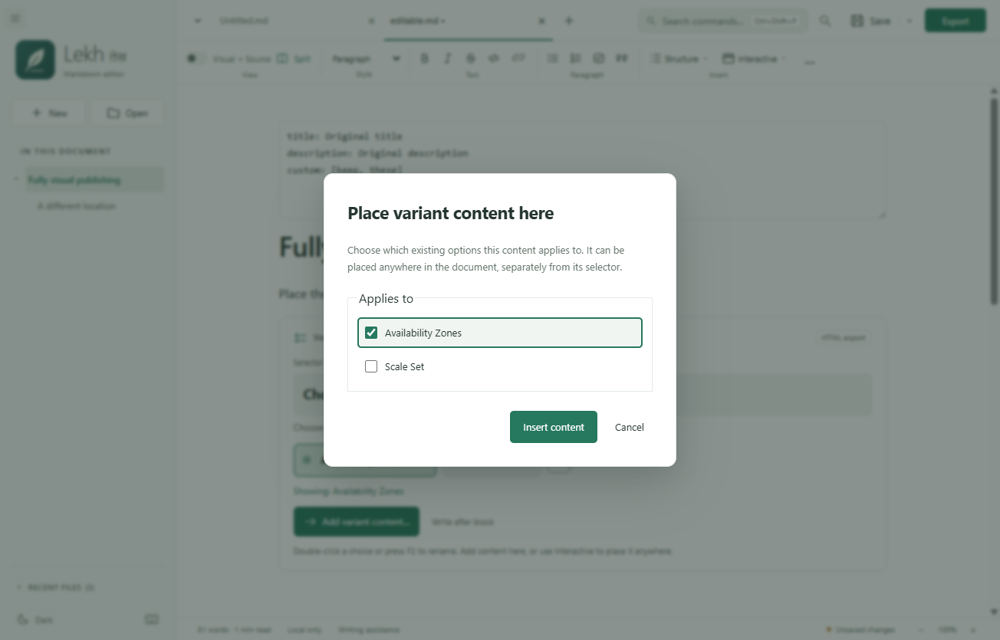
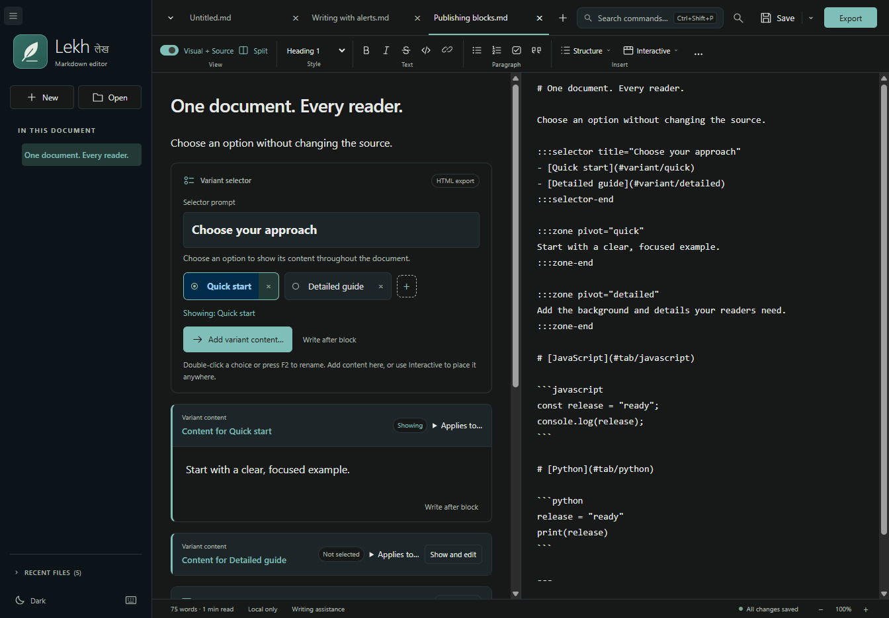
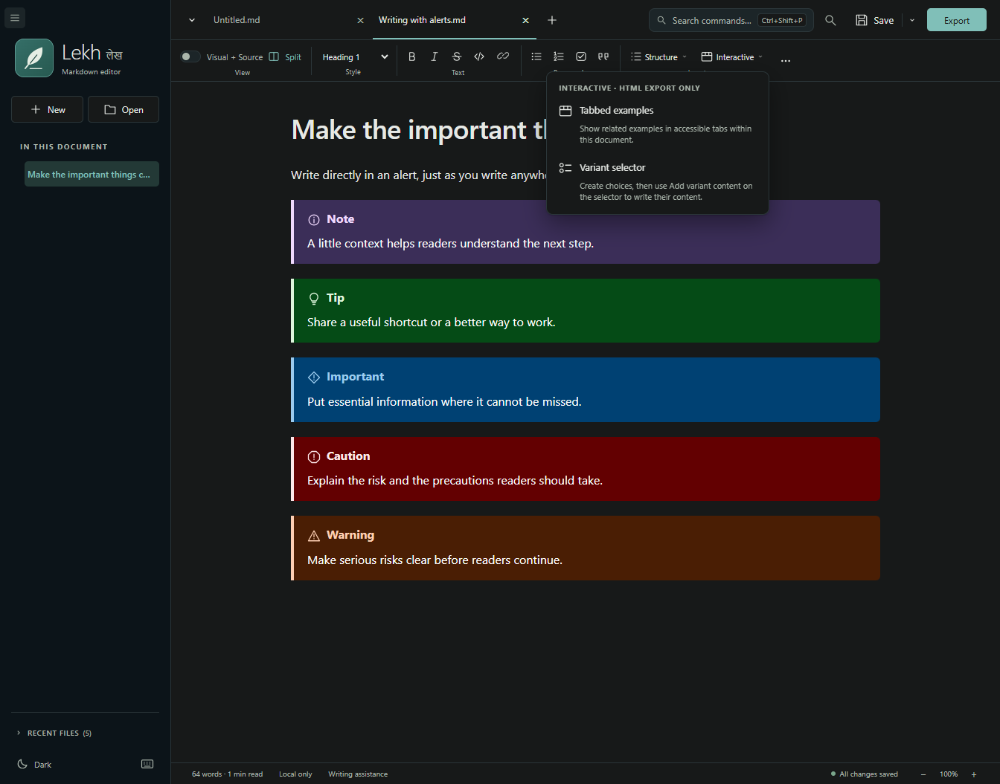
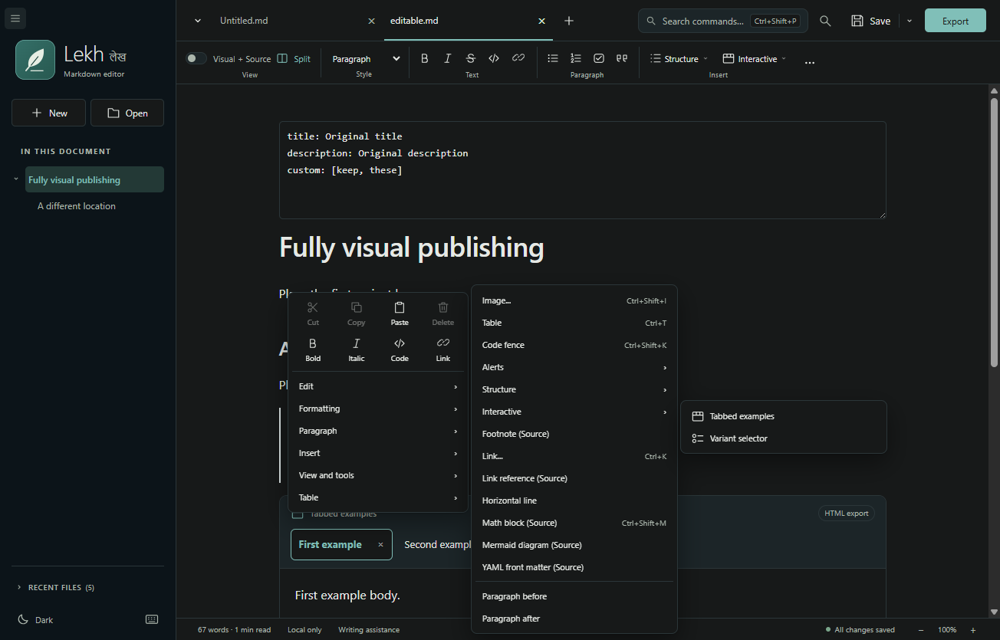
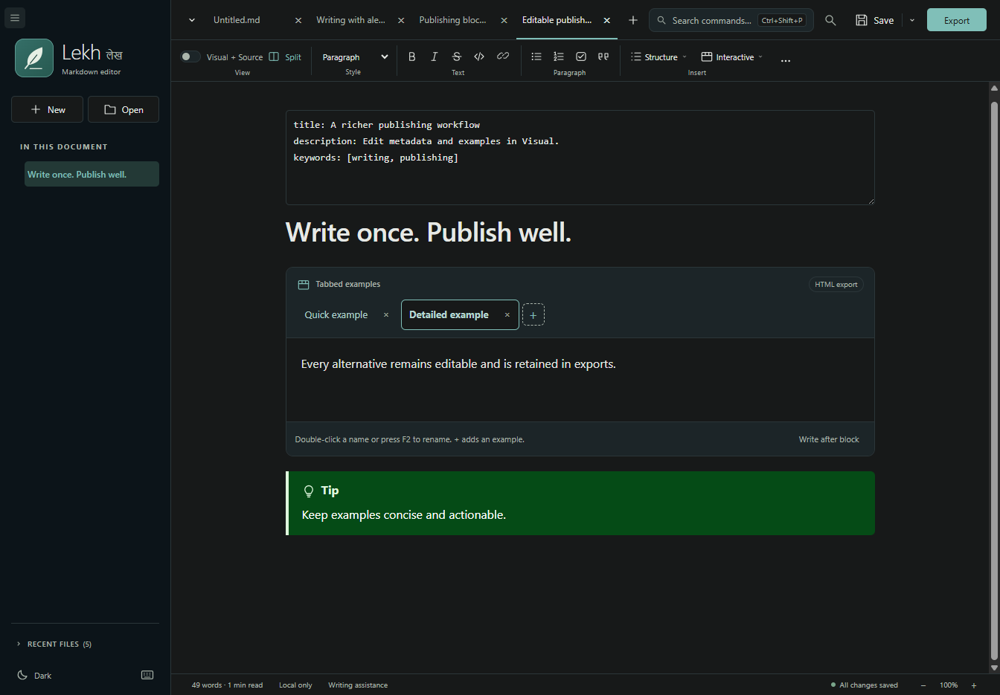
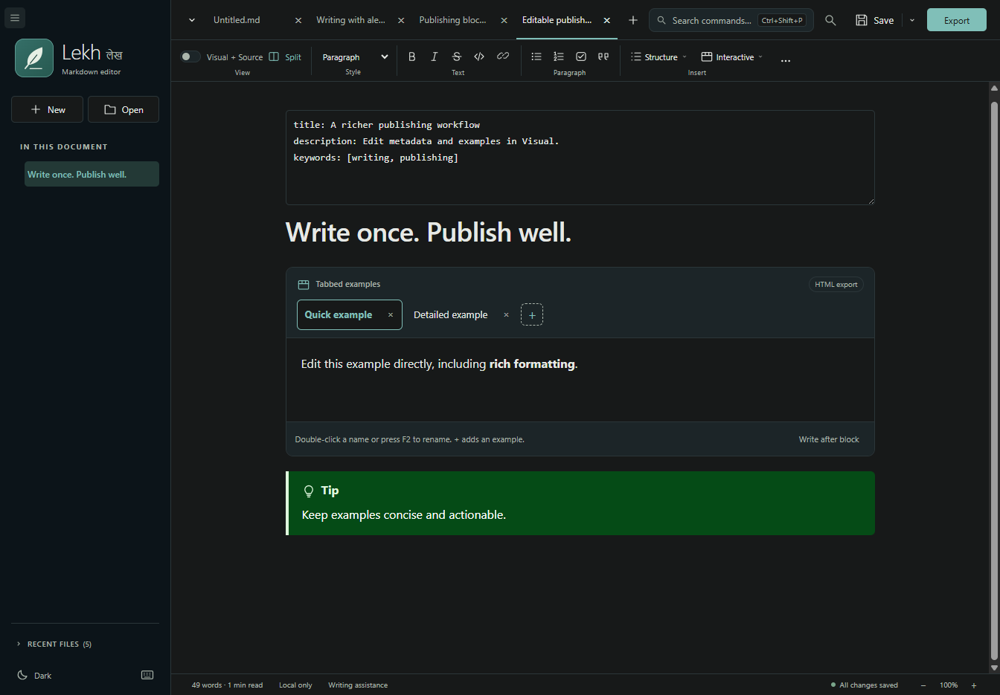

# Lekh user guide

A local-first Windows desktop application for writing Markdown with a friendly visual editor and exporting to interactive HTML, Word and PDF.

This guide describes Lekh's interactive offline HTML export, fully editable Visual publishing blocks, independently placed variant content, synchronized scrolling, and offline grammar checking. See the [latest verified release](https://github.com/dennispadia/lekh/releases/latest) for the installer.

## Open the application

Download the verified installer using the link in the [README](../README.md#install-on-windows). Run the Lekh setup EXE, which embeds its offline MSI engine and starts a fresh installation automatically. Open **Lekh** from your desktop or Start menu afterward. It installs for your current Windows user without requesting administrator access. If an older Lekh is running, setup asks you to save and close it; setup does not force-close the editor. The origin story supports Pause/Resume and Previous/Next, respects Windows' animation preference, and never delays installation.

**Installer behavior:** launching setup directly installs when Lekh is absent, or automatically upgrades a closed older version while showing both versions. Only a running editor prompts you to save and close; **Check again** proceeds directly once it is closed. The same version says **already installed** without offering reinstall, whether the editor is open or closed. Newer installed versions remain protected from downgrade. The old version is still removed before the new payload inside rollback protection; profiles and documents are preserved.

For a source checkout, double-click **Launch.cmd** in the project root. The developer build is **release\win-unpacked\Lekh - Markdown editor.exe**; keep that entire folder together.

Lekh uses a standalone `%APPDATA%\Lekh` profile for preferences, recent files, Chromium storage, and recovery drafts. Application files install to `%LOCALAPPDATA%\lekh`. **An existing Lekh profile is retained during upgrades; saved Markdown files can be opened normally.** It does not import another product's profile, use migration aliases, or uninstall another product. Its independent MSI upgrade code stays stable for future Lekh releases. Choose it explicitly for `.md` file associations if desired.

The 0.9.2 release passed genuine **0.9.1 -> 0.9.2** upgrade tests on a clean Windows runner, including automatic upgrades with Lekh closed and a single recheck after closing a running editor. Old registration and payload removal were verified before the new payload stage. Cancellation after removal restored the exact old registration and every old payload byte. Upgrade, repair and uninstall preserved seeded profile settings and a recovery sentinel. See [build and validation details](BUILDING.md#build-outputs).

No Microsoft Word, Pandoc, account, or internet connection is required to edit or export documents after setup. Images hosted on websites are deliberately not downloaded.

### If you need to rebuild

Double-click **Launch.cmd**. If the packaged app is missing, it runs **Setup.ps1**, downloads a private Node.js runtime from the official Node.js website, checks its SHA-256 checksum, installs the locked dependencies, and builds the app. Initial setup requires internet access and several hundred megabytes of disk space. It does not install Node.js system-wide or require administrator access.

To explicitly rebuild an existing copy, open PowerShell in this folder and run:

```powershell
powershell.exe -NoProfile -ExecutionPolicy Bypass -File .\Setup.ps1
```

The app is a local development build and is **not code-signed**. It is not a Microsoft Store app or a signed public installer.

## Your first document

1. Start writing in the blank **Untitled** document. Choose **New** for another blank page, or **Open** to edit an existing Markdown file. Launching with an Explorer file opens it directly, without an extra blank tab.
2. Write in **Visual** mode, just as you would in a word processor.
3. Use the toolbar for headings, bold, italics, strikethrough, lists, checklists, quotes, code, links, images, tables, and horizontal rules.
4. Choose **Save**, then select a name and location. The result is a normal UTF-8 `.md` file that other editors can open.
5. Choose **Export → Interactive HTML**, **Word document**, or **PDF document** to create a separate document. Documents containing tabbed examples or variants require HTML.

Export uses the **active tab's** current text, including unsaved edits. Exporting does not save or replace the Markdown source.

### Working with multiple files

- If Lekh is your Windows default for `.md` files, double-clicking a file in Explorer opens that document. Further files open as tabs in the existing window, which is restored if minimized. Reopening the same file focuses its tab without replacing unsaved edits.
- **Open file** and **New document** each open a new tab without replacing your other documents.
- Click a tab to switch documents. Each tab keeps its text, undo/redo history, Visual/Source mode, scroll position, and selection.
- A dot beside a tab's name means it has unsaved changes. Hover over the tab to see its full path.
- Tabs shrink and shorten their labels as the window narrows, like browser tabs. The **Open documents** arrow at the left lists every tab by name; when even compact tabs cannot fit, use that list to select a hidden tab. The selected tab stays visible. Neither tabs nor the editing toolbar require horizontal scrolling.
- Opening an already-open file focuses its existing tab, preserving any unsaved edits.
- **Save** and **Export** apply to the active tab. Click the arrow beside **Save** for **Save all files** (Ctrl+Alt+S) and **Save as** (Ctrl+Shift+S). Save all saves every modified tab, asking for filenames for new documents. Canceling a save stops Save all; already saved documents remain saved.
- Click a tab's **x** or press **Ctrl+W** to close it. Unsaved documents offer Save, Discard, and Cancel. Closing the final tab closes the entire window. Cancel, including canceling Save As, keeps your tab and window open.
- **Ctrl+Tab** and **Ctrl+Shift+Tab** move between tabs. The tab strip also supports Left/Right Arrow, Home, and End when focused.
- Closing the app checks **every** unsaved tab, not just the visible document. Cancel leaves all tabs open, even those you previously chose to discard during that exit attempt.
- To avoid conflicting edits, Save As cannot overwrite a file open in another tab.

### Paired split tabs

- Click **Split** beside the **Visual + Source** switch, choose **View > Split with...**, or right-click a tab and choose **Split with...**. Split pairs two different documents; Visual + Source shows two editable views of the same document. An Edge-style grid shows thumbnail previews, filenames, and paths for the other unpaired open documents. Click a card to create the pair, or use Tab and Enter/Space. Cancel or Escape leaves your tabs unchanged.
- Previews show the beginning of each document rendered as Markdown, including current unsaved edits and supported local/embedded images, even for files in Source mode. A dot marks unsaved changes. Remote images are not downloaded. Previews do not change editing modes, undo history, or selections.
- The two files become **one paired tab** in the shared tab strip. For example, five open files become one pair plus three individual tabs.
- Click a normal tab to display that file alone. Click the paired tab to restore both documents, their editing modes, scroll positions, and divider size.
- Each side keeps its own editing mode, editor, selection, and undo/redo history. There is only **one Visual + Source switch**, in the shared toolbar. Click a side to make it active; the switch reflects and changes only that side. The additional views in **More (...)** also apply only to the active side, as do the outline, formatting, Find, Save, and Export. **Save all** includes both sides and all other tabs.
- Drag the divider to resize. For keyboard resizing, focus the divider and use Left/Right; Home/End set the 25%/75% limits.
- **Unsplit**, also available from the pair's right-click menu and View menu, restores individual tabs in their original order without closing documents or losing edits.
- The pair's **x** closes both documents, checking unsaved changes in each before closing either. Cancel leaves both open. **Ctrl+W** or **Close active file** closes only that side and restores the remaining file as a normal tab.
- Pairing lasts while the app is open. Draft recovery preserves unsaved document contents, not split layouts.

### Offline writing assistance

Choose **Writing assistance** in the status bar and enable **offline English grammar checks**.
The setting is remembered; it starts off until you enable it. Harper runs on this device in a background worker,
without an account, server, download, or network request. Existing spelling suggestions remain separate.

- Grammar and punctuation suggestions are underlined in Visual and Source modes. Click an underline or use the suggestion list.
- Choose a proposed replacement to apply it, **Ignore** for that occurrence, or **Ignore throughout document** for the same rule and text in that tab.
- Applied changes use the editor's undo history. Merely checking, browsing or ignoring suggestions never changes saved or unsaved Markdown.
- Code and technical syntax are excluded; suggestions crossing protected formatting boundaries are omitted instead of risking damage to your document.
- Checks apply to the active document, including the active side of a split. Switching documents or editing invalidates old results before a replacement can be applied.
- Checks support up to 100,000 Markdown characters per document. The panel explicitly reports larger documents, processing errors, and result limits. Use **Check again** to retry.
- Ignore choices last for the current tab session. The tool is English-first, not a translation service, and grammar suggestions may be imperfect.

Close the panel to keep writing with underlines, or disable checking to stop the worker and remove grammar underlines.

### Publishing blocks and reader-friendly documents

The toolbar has one **Insert** section: **Image**, **Table** and **Code** buttons, plus **Alerts**, **Structure**, and **Interactive** menus with icons and labels. **Structure** contains table of contents, Mermaid diagrams, horizontal rules, image descriptions and document metadata. **Interactive** contains tabbed examples and variant selectors, with a reminder that these require HTML export. There is no separate Blocks insertion category.
The same commands are available from the native Insert menu and right-click **Insert > Alerts / Structure / Interactive**. At narrow widths, Structure and Interactive stay visible while lower-priority groups move into **More tools**.

A blank Visual document shows **Start writing, or press / for commands**, with a reminder about right-click tools. The hint disappears when you focus the empty paragraph and returns when you leave it empty. Source mode instead points to **Ctrl+Shift+P** for command search. Hints are UI guidance, not document content, and never appear in saved or exported files.
The **+** for a new document sits immediately after the rightmost visible document tab. It remains accessible when additional documents move into the open-documents menu.

#### Alerts: write directly in Visual

1. Put the caret in a paragraph, or select the paragraphs you want to format.
2. Choose **Alerts > Note, Tip, Important, Caution, or Warning**.
3. Type directly inside the alert. Use the normal toolbar for rich text, lists, links and code; there is no need to open Source to write its body.
4. With the caret inside an alert, choose another type to change it without replacing the content.
5. Press Enter to add a paragraph. Enter again on an empty final paragraph returns to normal writing outside the alert.

Each alert has a semantic icon, text label and colored leading border. Meaning does not depend on color alone.
Undo/redo includes alert insertion, body edits and type changes. Unchanged non-reference alerts retain their source syntax; edited alerts save as ordinary `> [!TYPE]` Markdown.
During Visual edits, reference links and images may be written with resolved inline destinations to keep dependencies valid across blocks. Manage shared reference definitions in Source when removing a block that owns them.
Supported containers, including tabs and variant bodies around an alert, are editable too. Local include directives stay visible but are not loaded.





#### Tabs and variant selectors

**Interactive** includes **Tabbed examples** and **Variant selector**. Image descriptions and document metadata are in **Structure**. Variant content is a follow-on action after creating a selector, not a separate starting option. Inline hints explain how to select, rename and add choices. New example and variant bodies are empty, with placeholders that disappear when clicked; there is no sample text to delete. Variant cards identify their assigned options and keep assignment controls in the header. Existing document text is never cleared when you focus it.
Select existing content before choosing tabs or variant content to retain it inside the new body. A selector inserts only choices, retaining selected prose separately rather than bundling variant bodies.

**Tabbed examples:** select a tab and type/format directly in its body, with no separate tab-name form above the content. Double-click the name on the tab, or focus it and press **F2**, to rename it in place. **Enter** finishes renaming; **Escape** restores the previous name. The Source heading's `#tab/` identifier follows the tab label (for example, **Service Principal** becomes `#tab/serviceprincipal`). The **+** immediately after the tabs adds an example and puts the caret in its body. Each tab has an **×** to remove that example; undo restores its name and complete content. Keep at least one tab or delete the entire group. **Write after block** places a normal paragraph after the group.

**Variant selector and distributed content:**

1. Insert **Interactive > Variant selector** once. Its labeled **Selector prompt** field starts empty: click the bordered box and type your own prompt, or leave it blank. Its placeholder is guidance, not saved text. Double-click a choice, or focus it and press **F2**, to rename it in place rather than using a duplicate option-name form. **+** adds a choice; **×** removes it once its content has been reassigned. Renaming a label keeps its stable ID and all matching content.
2. Click **Add variant content…** on the selector and select one or more existing options. Insert their content directly below the selector.
3. To place content elsewhere, put the caret there or select text to wrap, then choose **Interactive > Add variant content…**: the original selector menu entry changes to this action once a selector exists. The native Insert and right-click menus follow the same workflow.
4. Write and format directly in the new body. Repeat at other locations; content does not have to sit beside the selector.
5. Inactive content retains a compact card with **Show and edit**. **Applies to...** changes its option assignments; at least one assignment is required.
6. **Add option** adds a stable new ID. Removing an option is blocked while any variant content still uses it; reassign or remove that content first.

Tabs switch examples within one block. Variant selectors switch matching content throughout the current document; they are independent of tabs.
The selector must exist before creating its content, but its position imposes no restriction: variant content may appear before it, after it, or under other headings.



Selectors stay inside Visual or the rendered Preview. In Visual + Source, they never span or displace the Source column.
Source always retains every alternative. In Visual, inactive cards make hidden content visible and directly reachable for editing.
Read-only previews hide inactive content. Interactive HTML export retains all alternatives and lets the reviewer choose which to display.









#### Metadata and complex blocks

**Image with description** has editable source, alternate text and caption fields. A complex image's long description is rich editable content; **Add long description** creates one for an ordinary described image.
**Document metadata** is a single YAML field outside article content. Edit every field, including multiline values, directly in the box; arbitrary keys and comments are retained. Keep at least one `name: value` field or delete the entire block; delimiter lines are managed separately. Lekh does not evaluate YAML tags or claim complete schema validation.

Image captions are edited directly where displayed. Image source and alternate text remain available under **Image source and alternate text**, while long descriptions and variant content use normal rich document editing. These controls keep undo/redo and accessible field names without repeating visible form labels.
Documents containing tabbed examples, variant selectors, or variant content cannot be exported to DOCX or PDF. Those export options are disabled in the menu; choose **Export → Interactive HTML** instead. Local include directives are not resolved, so export restrictions are based only on the current document. Documents with metadata alone still support DOCX and PDF.
Unsupported or over-depth directives remain source-preserving and visibly identified. **Edit block** opens their raw syntax inline within Visual, without switching the document to Source.



Existing local include directives remain visible and editable as source-preserving blocks, but referenced files are never opened or loaded. Lekh does not fetch remote content. Relative images inside the Markdown file's folder continue to work; use **More (...) > Allow local image folder...** to grant this document access to images in a containing project folder. That grant is session-only and can be removed with **Stop local image folder access**.
If publishing labels are defined in a local `zone-pivot-groups.yml`, allowing the image folder also lets Lekh use those definitions. **Make these choices editable** creates one explicit Visual selector for this document; it does not modify the external configuration. This also enables independent variant-content insertion. Otherwise selectors show discovered IDs with an explanation.
Features requiring a publishing site's complete build pipeline are not simulated as successful output; unsupported syntax remains identified and preserved.

### Editor views and formatting

- **Visual + Source:** turn on the switch to edit Visual on the left and Source on the right. Edits update the other pane, and scrolling is synchronized in both directions by default using content anchors and measured wrapped Source lines, not only the whole-document percentage. Click the side you want to edit; formatting follows it. Turning the switch off keeps Visual and retains offsets. Space operates the focused switch. A two-file pair shares this switch, which controls only the active document; scrolling never drives the other document.
- **Single-editor views:** **More (...) > Visual only / Source only**, and **View > Visual / source** (Ctrl+/), retain the separate views. These mode changes reset undo history as before; simply showing Source alongside Visual does not recreate the editor. Visual edits can normalize Markdown syntax; use Source for exact syntax and unsupported constructs.
- **Single-row toolbar:** headings, bold, italic, strikethrough, inline code, all three list types, quotes, links, images, tables, code blocks, horizontal rules, table-of-contents insertion/update, and Mermaid insertion are directly accessible when space permits. Icons expose names and shortcuts on hover. As the window narrows, commands that no longer fit move into **More tools and views (...)**, with readable labels, rather than producing a scrollbar. Widening the window returns them to the toolbar. More also contains additional views and help; arrow keys navigate and Escape returns focus to its button. All commands remain available from the native menus. Save and Export keep their labels.
- **Compact right-click menu:** right-click in Visual or Source, or press **Shift+F10**. Two quick rows expose Cut, Copy, Paste, Delete, Bold, Italic, Code and Link. Other tools are grouped under **Edit**, **Formatting**, **Paragraph**, **Insert**, **Table** and **View and tools**. **Edit** contains Undo, Redo, Select All, Copy / Paste As, and move/duplicate/remove commands. **Insert** contains Image, Table, Code and **Alerts / Structure / Interactive**, matching the toolbar. Spelling suggestions get their own submenu when available. All options remain accessible, without a separate Block category. Submenus attach to their parent and flip/clamp at window edges; arrows navigate and Escape closes a level and restores focus. Clipboard actions preserve selection and target the clicked split side. Metadata/name/path inputs retain their native text-input menu.
- **Mermaid insertion:** place the caret where the diagram belongs and choose **Mermaid diagram** from the toolbar, its More menu, or Insert. In Visual, the diagram is inserted and rendered at that selection without switching modes; in Source, its fenced template uses the Source caret. In a split pair only the active document changes. Undo removes the insertion in one step.
- **Document outline:** click a heading on the left to navigate. Linked headings show their readable descriptions, not link addresses or Markdown formatting syntax; links in the document remain unchanged. Click a heading's chevron, or press Left/Right on it, to collapse or expand its subheadings. Drag a top-level heading, or press **Alt+Up/Down** on it, to move its whole section; moves never split publishing zones, tabbed examples or lists, and **Ctrl+Z** undoes them.
- **Command palette:** press **Ctrl+Shift+P**, or click **Search commands** in the header, to search every action, block and export. Type any words from a command name, then press Enter.
- **Slash menu:** in Visual, type `/` on an empty line to insert headings, lists, tables, alerts, tabbed examples, variants and other blocks. Each entry shows an icon and short description. Arrow keys choose, Enter inserts, Escape dismisses; Enter with no match simply starts a new line.
- **Block toolbar:** click into content in Visual to show a small floating toolbar for **Move up**, **Move down**, **Duplicate** and **Remove**. It hides while you type. The same commands are available from **Edit**, right-click **Edit**, and **Alt+Shift+Up/Down**.
- **Export panel:** **Export** shows Word, PDF and HTML cards with previews. When a document contains tabbed examples or variants, HTML is marked **Recommended** and Word/PDF are disabled with an explanation.
- **Links (0.6.2):** in Visual, click a link to edit its **Link text** and **Link address**, then choose **Save changes**. The link toolbar button, **Ctrl+K**, and right-click **Edit link...** also edit an existing link. **Remove link** keeps its text and formatting; Cancel leaves the document unchanged. Changing only the address preserves formatting within the label. Each change can be undone in one step. Use **Ctrl+click** to open a web/email link through the existing confirmation dialog, including in read-only Preview. Generated table-of-contents links still navigate with an ordinary click. Supported addresses are HTTP, HTTPS, `mailto:`, and `#heading` anchors. In Source, Ctrl+K continues to insert Markdown link syntax around the selection.
- **Tables:** right-click and choose **Table > Insert table...** or **Insert > Table**, click the table toolbar button, or press **Ctrl+T**. Choose columns and rows, then **Insert table**. Rows include the header; the limits are 100 rows and 50 columns. Cancel leaves your text unchanged. The same dialog works in Visual and Source modes. Click inside an existing table for controls to add or remove rows and columns.
- **Find and replace:** click **Find** or press **Ctrl+F** to toggle the bar; Close/Escape dismiss it without clearing your text. Search Markdown using **Match case** (on by default), **Whole word** (Unicode letters/numbers/underscore), or **Regex**. Previous/Next wrap around; Enter/Shift+Enter in Find navigate. Matches are counted and highlighted in Source. **Replace** changes the current result (or first result); **Replace all** changes every result in one undo step. Regex replacement supports `$1`, named groups, `$&`, and `$$`; literal replacement treats dollar signs literally. Navigation/replacement switches Visual to Source. Regex runs off the UI thread, stops after two seconds, and reports invalid expressions. Above 10,000 results, narrow the search before replacing; replacements cannot exceed the document size limit.
- **Source + Preview:** choose **More (...) > Source + Preview (read-only)** or **View > Source + Preview** to edit Source alongside a read-only rendering. **Sync scrolling** proportionally links scroll positions in either direction and can be unchecked. This is distinct from editable Visual + Source and pairing two files; each paired pane can use it. Returning to Source keeps its undo history; entering Visual retains the existing mode-switch history-reset behavior.
- **Undo and redo:** supported in both modes, independently for each tab. Switching tabs preserves history; switching single-editor Visual/Source modes resets that tab's history. In editable Visual + Source, undo follows the active editor; a Visual edit clears earlier Source-only snapshots so Source undo cannot overwrite that Visual edit with an obsolete snapshot.
- **Spelling:** native spell-checking in the visual editor. Availability and dictionaries depend on Windows.
- **Themes:** click the theme action at the bottom of the sidebar to alternate **Light** and **Dark**. **View > Color theme** also remains available. Dark combines graphite writing surfaces, a midnight sidebar, and muted teal accents. Older Dark and GitHub Dark preferences automatically migrate to Dark. The sidebar icon uses the brighter variant in Dark; Light and the Windows application icon retain the original artwork.
- **Sidebar toggle:** use the upper-left hamburger, **View > Toggle sidebar**, or **Ctrl+Shift+B**. The collapsed rail keeps New, Open, theme, and keyboard shortcuts available while hiding the outline/recent list. Your sidebar preference and expanded width are remembered.
- **Sidebar width:** drag the sidebar's right edge to resize it. Or focus the edge with Tab and use Left/Right for 10-pixel steps; Home/End set the limits. Double-click the edge to reset to 220 pixels. Width is remembered between launches, including when the sidebar is hidden. Limits are 200–480 pixels, further constrained in narrow windows to leave at least 480 pixels for the editor. Widening the window restores your preferred width.
- **Focus mode:** use **View > Focus mode** or **F9** to hide the sidebar and formatting toolbar. Press Escape or F9 to return to your previous sidebar preference. **View > Toggle sidebar** can also leave Focus mode and show the sidebar.
- **Recent files:** the list retains only the five most recently used files, newest first. Opening or saving an existing entry moves it to the top without adding a duplicate. Click the chevron/heading to expand or collapse the list and see its file count. It starts collapsed, remembers your preference, and scrolls independently when expanded so the document outline gets priority. Collapsing does not clear history or close files.
- **Word count and save state:** the status bar shows the active file's approximate word count and reading time. Click it for full document statistics (words, characters, paragraphs, headings, reading time); this is also **Document statistics** in the command palette. Click the save state to save. Counts include Markdown syntax.
- **Zoom:** use **- / percentage / +** at the right of the status bar to zoom the interface and editor. Click the percentage to reset to 100%. The percentage also follows zoom changes made through the existing View menu and keyboard shortcuts.
- **Save confirmation:** saving a file shows its actual filename, such as **Notes.md saved**. Save As uses the newly selected filename.
- **Clear recent files:** expand **RECENT FILES**, then click **Clear**, or use **File > Clear recent files**. This clears only the saved history, not your Markdown files, open tabs, or recovery drafts. Opening or saving a file adds it to the history again.

### Formatting keyboard shortcuts

These work in both Visual and Source modes, including the active side of a split. Hover over a toolbar control to see its shortcut. **Help > Keyboard shortcuts** or **F1** opens the reference.

| Action | Shortcut |
| --- | --- |
| Bold | Ctrl+B |
| Italic | Ctrl+I |
| Strikethrough | Ctrl+Shift+X |
| Inline code | Ctrl+E |
| Bullet list | Ctrl+Shift+8 |
| Numbered list | Ctrl+Shift+7 |
| Task list | Ctrl+Shift+9 |
| Block quote | Ctrl+Shift+Q |
| Paragraph / Headings 1-6 | Ctrl+0 / Ctrl+1-6 |
| Insert / edit link | Ctrl+K |
| Open link (confirmation for web/email) | Ctrl+click |
| Insert image | Ctrl+Shift+I |
| Insert table | Ctrl+T |
| Code block | Ctrl+Shift+K |
| Undo / Redo | Ctrl+Z / Ctrl+Shift+Z |

Formatting shortcuts are scoped to document editors, not Find fields, dialogs, or the code-language search box. Existing file, tab, sidebar, and Focus-mode shortcuts are unchanged.

### Code blocks and languages

- Insert a code block with the **Code block** icon (under **More formatting** in narrow windows), Ctrl+Shift+K, or **Insert > Code fence**. In Visual mode, use the language selector at the bottom-right of each block.
- Search the offline language catalog by name or alias, such as **PowerShell**, **ps1**, **Python**, **JavaScript**, **C#**, **JSON**, or **YAML**. Arrow keys navigate results; Enter selects; Escape closes the picker.
- Choosing a language applies syntax colors immediately, with light/dark palettes matching your theme. It does **not** rewrite indentation, reformat, or run your code.
- **Plain text** disables highlighting. Existing unsupported language labels are preserved and displayed as plain text, never guessed.
- In Source mode, specify the language after the opening fence, for example three backticks followed by `powershell`. Languages and code contents survive saving, reopening, and tab/mode switches.
- **Copy** copies only the block's code, preserving its whitespace. PDF and Word exports include syntax colors using a print-friendly light palette, without the editor's buttons or language picker.

### Right-click Markdown menu

Right-click inside the visual editor or Markdown source to access:

- **Cut, Copy, Paste, Select All, Delete selection, Undo, and Redo**, with spelling suggestions when available.
- **Edit link...:** shown when right-clicking a link in Visual, with its current text and address prefilled.
- **Copy / Paste As:** copy a selection or the full document as Markdown, paste as plain text, paste Markdown as formatted content in Visual mode, or explicitly **Paste image**.
- **Formatting:** bold, italic, strikethrough, inline code, quotes, bullet/numbered/task lists, and Clear formatting in Visual mode.
- **Paragraph:** Heading 1 through Heading 6, or normal Paragraph. The current style is checked.
- **Insert:** image, footnote, link, link reference, horizontal line, table, code fence, math block, table of contents, YAML front matter, and a paragraph before or after the current block (current line in Source mode).
- **Table:** **Insert table...** is always available, even before a table exists. Row/column controls are enabled only inside an existing table in Visual mode.

Paragraph and Insert commands are also available under the native **Edit** menu.

**Footnote, link reference, math block, and YAML** commands insert editable Markdown syntax in **Source mode**. From Visual mode they insert at the document's end (YAML goes at the top); from Source mode they use the current selection. YAML insertion refuses to duplicate an existing opening front-matter block. Footnotes and link references use unique reference numbers. Math and footnotes do not have formatted rendering or structured export support yet; keep them in Source mode to preserve the syntax. YAML is preserved in the metadata view and omitted from article-body exports. Standard Markdown link references are resolved by the renderer/exporter.

**Table of contents** is one action: it inserts a marked list when none exists, then refreshes that same list when used again after changing headings. The list is enclosed by `<!-- lekh:toc -->` and `<!-- /lekh:toc -->`; refresh replaces only that marked block, preserving surrounding source. Duplicate heading names get distinct anchors. Visual editing preserves the block as a single contents node. Refresh requires exactly one well-formed marked block outside code fences; unmarked lists must be replaced with a newly inserted marked contents list. Its links navigate within Visual, Preview/PDF, and exported Word documents; Word uses heading bookmarks for internal destinations.

### Mermaid diagrams

Choose **Mermaid diagram** in the toolbar, **More tools and views > Mermaid diagram** when it has moved into overflow, or **Insert > Mermaid diagram** for a flowchart starter at the current selection. Visual insertion stays in Visual; Source-only insertion opens Source + Preview, while editable Visual + Source stays enabled if already in use. A fenced block labelled `mermaid` renders locally in Visual and Preview, without running code or using a cloud service. PDF and Word exports render diagrams independently in an isolated local page and include PNG images.

Supported diagram families are flowchart, sequence, class, state, entity-relationship, pie, journey, and timeline. Diagram configuration directives/front matter are ignored; links, HTML, external resources, callbacks and custom shapes are disabled. Limits include 12,000 source characters, 250 lines, 350 statements, 200 edges and 32 diagrams per preview/export. Export images are limited to 4096 pixels per dimension and eight million pixels. Unsupported/invalid diagrams show an error with the source retained; export fails explicitly rather than silently dropping a diagram. Math rendering is still unsupported.

### Keyboard shortcuts

| Action | Shortcut |
| --- | --- |
| New document | Ctrl+N |
| Open | Ctrl+O |
| Save | Ctrl+S |
| Save As | Ctrl+Shift+S |
| Save all modified tabs | Ctrl+Alt+S |
| Close tab | Ctrl+W |
| Next / previous tab | Ctrl+Tab / Ctrl+Shift+Tab |
| Export PDF | Ctrl+P |
| Find and replace | Ctrl+F |
| Undo | Ctrl+Z |
| Redo | Ctrl+Shift+Z |
| Visual / Source | Ctrl+/ |
| Focus mode | F9 |
| Toggle sidebar | Ctrl+Shift+B |
| Bold / italic in both modes | Ctrl+B / Ctrl+I |
| Keyboard shortcut reference | F1 |
| Heading 1 through 6 / Paragraph | Ctrl+1 through Ctrl+6 / Ctrl+0 |
| Insert image | Ctrl+Shift+I |
| Insert table | Ctrl+T |
| Code fence | Ctrl+Shift+K |
| Math block (Source) | Ctrl+Shift+M |

## Keeping your work safe

- You are asked to **Save, Discard, or Cancel** before closing a tab with unsaved edits. App exit checks all modified tabs.
- Saves use a temporary file in the destination folder followed by a rename. If a save fails, an error is displayed.
- If another application changes or deletes the current file, Save refuses to overwrite it. Use **Save As** with a different name to preserve your version, then compare it with the original.
- Local recovery drafts for **all unsaved tabs** are stored after roughly 700 ms of inactivity. On your next launch, use **Recover drafts** to restore each one in a new, unsaved tab. Save them to keep them.
- If recovery storage is full or unavailable, the application reports the problem. A pending recovery draft is retained until you recover or dismiss it.
- **Recovery is not autosave or a backup.** Save regularly and back up important documents. Recovery holds the current unsaved documents per application profile, not a document archive. The browser's storage quota applies to their combined size.
- Markdown files are limited to **10 MB** and must be valid UTF-8 text.

## Images and exports

**Insert image**, clipboard image paste, and image drag/drop offer **Embed in document** or **Save in this document's assets folder**. Embed is selected by default: it creates a portable data URL but increases Markdown/recovery size. Assets are available only after saving the Markdown file. Images get unique non-overwriting names under its `assets` folder and relative Markdown links. Unsafe asset folders (including links/junctions) and malformed images are rejected with an error. Cancellation does not insert an image. Drop one PNG, JPEG, GIF, or WebP at a time; the image limit is 20 MB, and embedded documents still have the 10 MB limit.

**Clipboard images and screenshots:** copy an image or capture a screenshot, then use **Ctrl+V**, **Edit → Paste**, or right-click **Paste**. A clipboard bitmap becomes PNG; choosing embedding in Source produces ``, while choosing assets produces a relative file link. Image-file paste events also support JPEG, GIF, and WebP. Right-click an image and choose **Copy image** to copy its bitmap for use in another document or application. Copy/cut of an individually selected image is also supported. Clipboard bitmaps do not preserve GIF animation. Remote HTML image links are not downloaded.

Embedded pasted images remain inside the saved Markdown file and can be reopened or exported to HTML, Word or PDF, with no separate folder to manage. For assets, keep the `assets` folder with the Markdown document when copying or sharing it. The 10 MB document limit still applies.

Existing relative image paths, such as `assets/photo.png`, are supported when the image is inside the saved Markdown file's folder or one of its subfolders. Access outside that folder, absolute file paths, and remote downloads are blocked. To use an image elsewhere, insert it using the toolbar. Moving a document with relative images requires copying its image folders, too; Save As warns when changing folders.

### Interactive HTML for offline review

Choose **Export → Interactive HTML** to create one `.html` file, then open it in a browser. Images and rendered Mermaid diagrams are embedded; the document does not need an internet connection or a separate assets folder. External links can still lead to websites when clicked.

Click an example tab or use Left/Right, Home and End to navigate its tabs. Variant choices update matching content throughout the document, including content above the selector. Heading links reveal the tab and variant containing their destination, including nested examples. If variant content has no selector, HTML provides one using the variant IDs. When JavaScript is disabled, all labeled alternatives remain visible instead of becoming inaccessible.

The HTML file contains **all** alternatives, including those not currently selected. Local include directives remain inert and their referenced files are never read. Share the exported file only with people allowed to see the entire document. Metadata remains outside the exported article. Missing, invalid, remote or unauthorized images cause an explicit export error.

### DOCX and PDF formatting

Export uses the active document's current contents, including unsaved edits, and creates a separate file without saving the Markdown. DOCX and PDF are available when the document does not contain tabbed examples or variants. Both formats use a readable **light print palette regardless of the editor theme**, so Dark mode does not produce dark pages.

- **Heading hierarchy and typography:** Lekh explicitly defines Segoe UI Heading 1–6 sizes, weights, spacing, and colors, rather than relying on a receiving application's default heading styles. Body text, quotes, and code have their own print formatting.
- **Word line spacing:** DOCX uses **1.15** line spacing throughout, including headings, lists, table cells and code. Paragraph gaps remain separate from line spacing. This does not change the Visual editor, HTML or PDF layout.
- **Inline formatting and links:** bold, italic, and strikethrough are preserved. Hyperlinks are colored and underlined. Internal heading links, including generated table-of-contents links, are clickable; Word uses heading bookmarks for their destinations.
- **Tables:** fixed, page-width layouts preserve left/center/right Markdown column alignments. Header rows are shaded and repeat when a table continues onto another page.
- **Lists and tasks:** nested lists preserve their structure, continuation paragraphs, and ordered-list starting numbers. Task lists render checked/unchecked boxes, not interactive Word form controls.
- **Code:** inline and fenced code retain print-friendly formatting. Fenced code preserves syntax colors, blank lines, and tabs without including editor buttons or language pickers.
- **Images and diagrams:** supported images and Mermaid diagram images preserve their aspect ratio and are constrained to the available page area. Word supports PNG/JPEG/GIF; convert WebP to PNG or JPEG before Word export. PDF also supports WebP.
- **Pages and accessibility:** exports use A4 pages with 20 mm margins. PDF includes document bookmarks and tagged accessibility, with readable print typography and automatic page breaks.

Word output remains editable and reflows according to the receiving application's fonts and layout engine. DOCX and PDF are **not pixel-identical**, and page breaks may differ. Check the exported document before sharing, especially long tables, code, and complex nested content.

- Missing, unreadable, or unsupported export images cause an explicit error instead of silently disappearing.
- Raw HTML is treated as text during export, not executed.
- Math and footnotes do not have formatted rendering or structured export support; use Source mode to preserve their Markdown syntax. YAML remains metadata rather than article text. Standard Markdown link references are resolved.

## First-version boundaries

Visual editing can normalize Markdown syntax and may not preserve unsupported constructs. Use **Source mode** for exact editing of YAML front matter, raw HTML, math, footnotes, or custom Markdown extensions. Simply opening, switching modes, and saving without edits preserves the original text.

Not included yet: a folder workspace, cloud sync, automatic updates, custom export templates, manual advanced pagination controls, interactive Word form checkboxes, and LaTeX rendering. Task lists export as rendered boxes, not interactive form controls. Math and footnotes do not have formatted rendering or structured export support; metadata is not article body text.

## Privacy

The app does not upload documents or collect analytics. Local images are read only as needed. Opening a web/email link requires confirmation and uses your default external application, which may access the internet. Development/setup tools need network access for downloads.

Recent file paths, theme preference, and recovery data are stored in `%APPDATA%\Lekh`. Documents themselves remain where you choose to save them.

## Bugs, enhancements, and requests

[Open a GitHub issue](https://github.com/dennispadia/lekh/issues) with a question, reproduction steps, or a description of the desired workflow. Screenshots and small, non-sensitive samples are helpful. Do not include private documents or credentials. See [Help and feedback](../SUPPORT.md).

## Development and validation

See the [build guide](BUILDING.md) for MSI packaging and development. The application uses Electron, TypeScript, Vite, Tiptap, markdown-it, and docx. Dependencies are locked in `package-lock.json`.

If using the private runtime installed by setup:

```powershell
$env:PATH = "$PWD\.tools\node-v22.22.0-win-x64;$env:PATH"
npm.cmd test
npm.cmd run test:desktop
npm.cmd run package
```

- `npm test`: unit tests for Markdown helpers, DOCX contents, print HTML, image boundaries, and safe file writes.
- `npm run test:desktop`: builds and launches the real desktop app with an isolated temporary profile. Exercises visual typing, formatting, actual native right-click menus, source-only insertions, table-of-contents links, checkbox alignment (within 1 px of the first text line, including wrapped/nested tasks), per-tab state and undo, duplicate-file handling, Save All, closing tabs/app with unsaved work, native file handlers, exact source preservation, find/replace, external-change protection, interactive HTML export and its offline fallbacks, DOCX/PDF generation and restrictions, themes, and multi-tab draft recovery. Native dialog selections and clipboard contents are supplied through a test-only debugger connection; production code has no dialog bypass, and tests do not alter your real clipboard.
- `npm run package`: creates `release\win-unpacked`.
- `npm run generate:icon`: regenerates the multi-resolution Windows icon and window PNG from the original Enchanted Quill artwork in `assets/icon.svg`: an ivory feather and gold writing stroke on emerald, without a crescent. Builds run this automatically. The application remains unsigned; icon and version resources are embedded without code signing.
- To test the packaged executable: `node scripts\smoke.mjs "release\win-unpacked\Lekh - Markdown editor.exe"`.

Desktop tests enable loopback debugging only for the test process and close it afterward. The normal launcher does not enable debugging.
